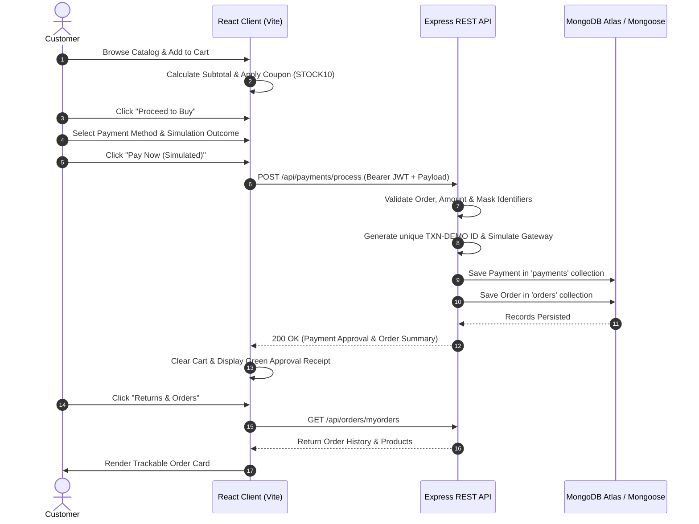

# Stock Shop: E-Commerce Customer Management & Simulated Payment System
## Final Project Documentation & Academic Submission Report

---

### 1. Project Description
**Stock Shop** is a full-stack MERN (MongoDB, Express.js, React.js, Node.js) web application designed as an e-commerce platform with customer relationship management and a multi-channel simulated payment gateway. Built with an Amazon-inspired design language, the system demonstrates modern full-stack concepts:
- Encrypted customer registration and authentication using **bcrypt** and **JSON Web Tokens (JWT)**.
- Product catalog exploration with category filtering, real-time keyword search, and responsive product cards.
- Persistent shopping cart with quantity controls, subtotal recalculations, and coupon discounts (`STOCK10`).
- Academic demo payment simulation supporting **UPI**, **Debit Card**, **Credit Card**, and **Net Banking** with instant generation of unique transaction IDs (`TXN-DEMO-...`). Zero real money or sensitive CVVs/PINs are stored.
- Customer order tracking with line-item breakdowns, invoice previews, and past order histories.
- Role-based **Executive Admin Dashboard** providing 7 core KPI metrics (customers, products, orders, total sales, approved, failed, and pending payments) along with dedicated management tables.

---

### 2. Project Objectives
1. **Academic Demonstration of Secure Authentication:** Demonstrate one-way password hashing (bcrypt, 10 rounds) and stateless session management with Bearer JWT tokens.
2. **Robust Multi-Collection Database Architecture:** Implement 4 distinct Mongoose schemas (`customers`, `products`, `orders`, `payments`) with cross-referencing identifiers.
3. **Safe Payment Gateway Simulation:** Model the operational state machine of a financial payment gateway (Validation → Gateway Handshake → Outcome Evaluation [SUCCESS / FAILED / PENDING] → Transaction Logging → Order Status Synchronization) without security risks or real monetary exposure.
4. **Resilient Dual-Mode Storage:** Provide an automated in-memory fallback layer ensuring 100% operational uptime during offline demonstrations or viva evaluations if local MongoDB services are inactive.
5. **Production-Ready Deployment Capability:** Architect the application for separation of concerns, deploying the frontend on Vercel, the REST API backend on Render, and the database on MongoDB Atlas.

---

### 3. Technology Stack

| Layer | Technologies Used | Purpose |
|---|---|---|
| **Frontend UI** | React 19, Vite 8, Tailwind CSS v4, Lucide Icons | Responsive desktop & mobile storefront, state management |
| **HTTP Client** | Axios 1.21 | REST API communication with Bearer JWT interceptors |
| **Backend Runtime** | Node.js (v18+), Express.js 5 | Scalable RESTful API, route routing, and middleware pipeline |
| **Security & Auth** | bcryptjs, jsonwebtoken (JWT), dotenv, cors | Password encryption, token signing/verification, and CORS |
| **Database** | MongoDB 6+, Mongoose 9 ODM | Document persistence for customers, products, orders, and payments |
| **Production Cloud** | Vercel (Frontend), Render (Backend), MongoDB Atlas (Database) | Serverless edge hosting, containerized web service, cloud DB |

---

### 4. Database Structure & Collections

```
                       ┌──────────────────────┐
                       │   Customers Schema   │
                       ├──────────────────────┤
                       │ customerId (Unique)  │
                       │ fullName             │
                       │ email (Unique)       │
                       │ phoneNumber          │
                       │ passwordHash (bcrypt)│
                       │ address {city, PIN}  │
                       │ role ('customer'/'admin')
                       │ registrationDate     │
                       └──────────┬───────────┘
                                  │ 1:N
                                  ▼
┌──────────────────────┐       ┌──────────────────────┐       ┌──────────────────────┐
│   Products Schema    │       │    Orders Schema     │       │   Payments Schema    │
├──────────────────────┤       ├──────────────────────┤       ├──────────────────────┤
│ productId (Unique)   │       │ orderId (Unique)     │       │ transactionId (Unique│
│ productName          │       │ customerId           │ 1:1   │ orderId              │
│ description          │◄──────┤ productsPurchased[]  ├──────►│ customerId           │
│ category             │  N:M  │ totalAmount          │       │ paymentMethod        │
│ price                │       │ orderStatus          │       │ amount               │
│ stockQuantity        │       │ orderDate            │       │ paymentStatus        │
│ productImage         │       │ paymentId            │       │ transactionDate      │
│ badge                │       └──────────────────────┘       │ paymentDetails {}    │
└──────────────────────┘                                      └──────────────────────┘
```

#### Detailed Schema Fields:
1. **`customers` Collection:**
   - `customerId` (String, Indexed): Unique ID (`CUST-XXXXXX-XXXX`).
   - `fullName` (String): Customer's name.
   - `email` (String, Indexed): Normalized unique email.
   - `phoneNumber` (String): Contact phone.
   - `passwordHash` (String): One-way bcrypt hash.
   - `address` (Object): `{ street, city, state, pincode, country }`.
   - `role` (String): `'customer'` or `'admin'`.
   - `registrationDate` (Date): Account creation timestamp.

2. **`products` Collection:**
   - `productId` (String, Indexed): Unique product code (`PROD-XXX-XXX`).
   - `productName` (String): Catalog title.
   - `description` (String): Item details & specifications.
   - `category` (String): E.g., `Electronics`, `Audio`, `Wearables`, `Gaming`, `Accessories`.
   - `price` (Number): Price in INR (₹).
   - `stockQuantity` (Number): Inventory stock count.
   - `productImage` (String): Image URL.
   - `badge` (String): E.g., `Stock Shop's Choice`, `Best Seller`.

3. **`orders` Collection:**
   - `orderId` (String, Indexed): Unique order code (`ORD-XXXXXX-XXXX`).
   - `customerId` (String): Associated customer ID.
   - `customerDetails` (Object): Snapshot of customer name, email, phone, and delivery address.
   - `productsPurchased` (Array): Line items `[{ productId, productName, price, quantity, productImage }]`.
   - `totalAmount` (Number): Total order cost.
   - `orderStatus` (String): `'Confirmed'`, `'Processing'`, `'Delivered'`, `'Cancelled'`.
   - `orderDate` (Date): Timestamp of placement.
   - `paymentId` (String): Linked payment transaction reference.

4. **`payments` Collection:**
   - `transactionId` (String, Indexed): Unique gateway ID (`TXN-DEMO-XXXXXXXX`).
   - `orderId` (String): Reference to matching order.
   - `customerId` (String): Reference to customer.
   - `paymentMethod` (String): `'UPI'`, `'DEBIT_CARD'`, `'CREDIT_CARD'`, `'NETBANKING'`.
   - `amount` (Number): Transaction amount in INR (₹).
   - `paymentStatus` (String): `'SUCCESS'`, `'FAILED'`, `'PENDING'`.
   - `transactionDate` (Date): Timestamp of payment execution.
   - `paymentDetails` (Object): `{ maskedCard, upiId, bankName, gatewayResponse }`.

---

### 5. Application Workflow



---

### 6. Features Explanation

1. **Responsive Amazon-Themed Storefront:**
   - Dark navy header with live location delivery pill, interactive search bar, category selector, account dropdown, and badge cart counter.
   - Secondary ribbon with quick links to categories, deals, and **Stock Shop Pay**.
   - Festival hero banner with dynamic deal buttons and trust badges (Free shipping, 100% secure payment, 7-day replacement).
2. **Shopping Cart & Checkout Engine:**
   - Live quantity increment/decrement with instant subtotal and tax calculation.
   - Coupon discount code input (`STOCK10` applies a 10% instant discount).
   - Safe checkout form pre-filling verified customer address details.
3. **Simulated Payment Gateway:**
   - Interactive options: **UPI** (PhonePe / GPay / Paytm), **Debit Card**, **Credit Card**, **Net Banking**.
   - Demo simulation outcomes:
     - **SUCCESS:** Captures funds, generates `TXN-DEMO-...`, creates order, clears cart.
     - **FAILED:** Simulates bank decline, displays actionable error message, preserves cart.
     - **PENDING:** Simulates bank network pending confirmation.
   - Clear banner: `DEMO PAYMENT - NO REAL MONEY`.
4. **Customer Account & Orders History:**
   - View and update profile details with instant save to MongoDB.
   - Order history with line items, product thumbnails, order date, total price, and invoice modal.
5. **Executive Admin Dashboard:**
   - **7 Core KPIs:** Total Customers, Total Products, Total Orders, Total Revenue, Approved Payments, Failed Payments, Pending Payments.
   - **Manage Customers Tab:** Search by name/email/ID/phone.
   - **Manage Products Tab:** Add new product modal, delete product, category filter.
   - **Manage Orders Tab:** Status filter, live status update dropdown (`Confirmed`, `Processing`, `Delivered`, `Cancelled`).
   - **Payment Transactions Tab:** Full audit trail with status badges (`SUCCESS`, `FAILED`, `PENDING`).

---

### 7. Future Enhancements
1. **Real Payment Gateway Integration:** Add Razorpay or Stripe test mode SDK keys for sandbox webhook processing.
2. **Automated Email & SMS Notifications:** Integrate Nodemailer and Twilio for order confirmation emails and SMS delivery alerts.
3. **Product Reviews & Star Ratings System:** Allow authenticated customers who purchased an item to upload photo reviews and star ratings.
4. **AI-Powered Product Recommendations:** Implement collaborative filtering or vector embeddings to suggest related products based on order history.
5. **Multi-Vendor Seller Portal:** Provide a vendor login enabling independent sellers to manage their own inventories and track payouts.

